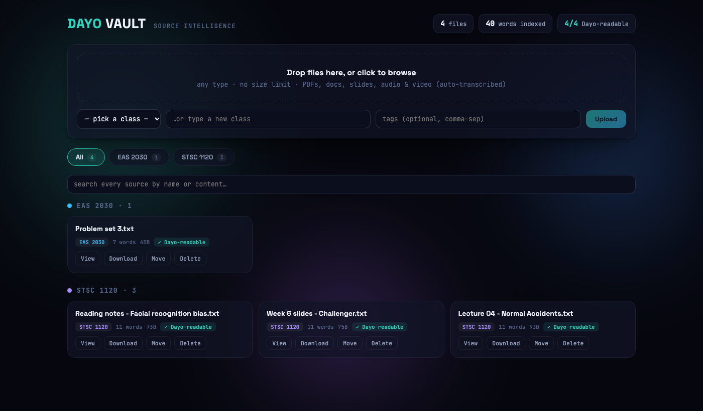

# Dayo Vault

A self-hosted file vault that turns anything you upload into searchable text. Drop in PDFs, Word docs, slides, or hours of lecture video, and every word becomes full-text searchable in one place.

I built it because Discord's 50MB upload cap kept blocking course readings and recorded lectures from reaching my AI assistant (Team Dayo). The vault became the assistant's source library: anything uploaded here can be found and cited.



## What it does

- **No upload size limit.** Uploads stream to disk in 1MB chunks, so a large file never sits in memory. A 120MB upload finishes in about 1.3 seconds on an 8GB MacBook Air.
- **Text extraction** for PDF, DOCX, plain text, Markdown, CSV, JSON, and source code.
- **Audio and video transcription.** ffmpeg pulls 16kHz mono audio and splits it into 10-minute segments to stay under the Whisper API's 25MB limit, then the transcripts are stitched back together. Five course videos (4,230 words) cost $0.22 to transcribe.
- **Full-text search** over file names, tags, notes, and the entire extracted text using SQLite FTS5.
- **Background job queue.** A worker thread picks up audio and video after upload (pending → processing → done/failed) and re-queues anything left unfinished after a restart.
- **Soft delete.** Deleted files move to a trash folder; nothing is permanently removed.

## Design notes

- **SQLite in WAL mode with a write lock.** Searches keep working while an upload or transcription is writing, and concurrent writes can't corrupt the index. It replaced an earlier flat JSON inventory, which it migrates automatically on first run.
- **Absolute paths for ffmpeg.** macOS launchd starts services with a minimal `PATH` that excludes Homebrew, so a bare `ffmpeg` call worked in a terminal but failed silently as a service. The server resolves binaries to absolute paths at startup.
- **No build step on the frontend.** React and Framer Motion are vendored and served as static files by FastAPI, so the whole app is one `uvicorn` command.

## Stack

Python, FastAPI, SQLite (FTS5, WAL), ffmpeg, OpenAI Whisper API, React, Framer Motion

## Run it

```bash
python3 -m venv .venv && source .venv/bin/activate
pip install -r requirements.txt
cp .env.example .env   # add OPENAI_API_KEY for transcription
uvicorn vault_server:app --host 127.0.0.1 --port 8500
```

Open http://localhost:8500. Transcription also needs `ffmpeg` (`brew install ffmpeg`).

## API

| Method | Route | Purpose |
|---|---|---|
| POST | `/api/upload` | Stream a file in, extract text, index it |
| GET | `/api/search?q=` | Full-text search |
| GET | `/api/files` | List files |
| GET | `/api/file/{id}/text` | Extracted text or transcript |
| GET | `/api/file/{id}/download` | Original file |
| POST | `/api/file/{id}/transcribe` | Queue transcription |
| GET | `/api/transcription/status` | Queue status |
| POST | `/api/file/{id}/delete` | Move to trash |
